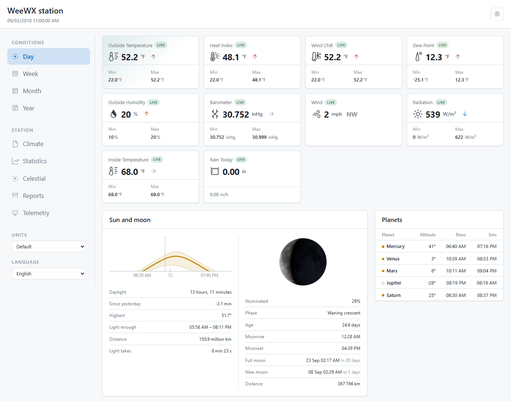
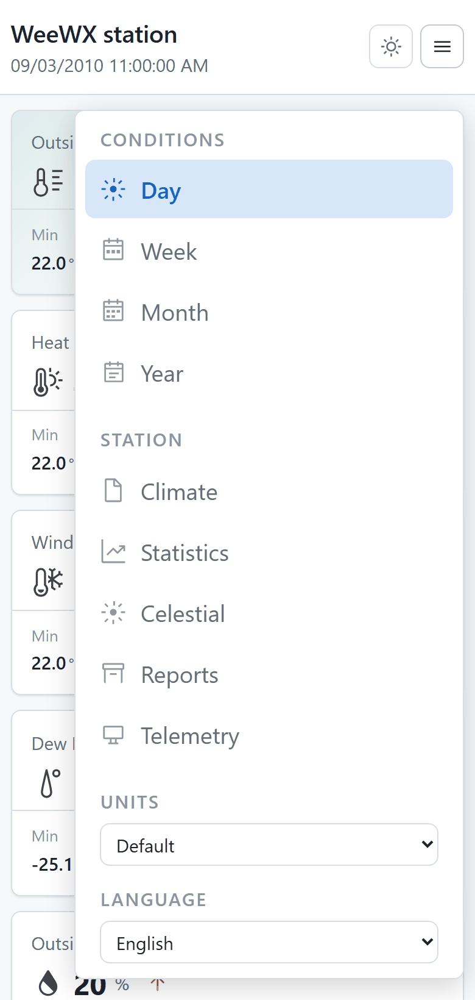
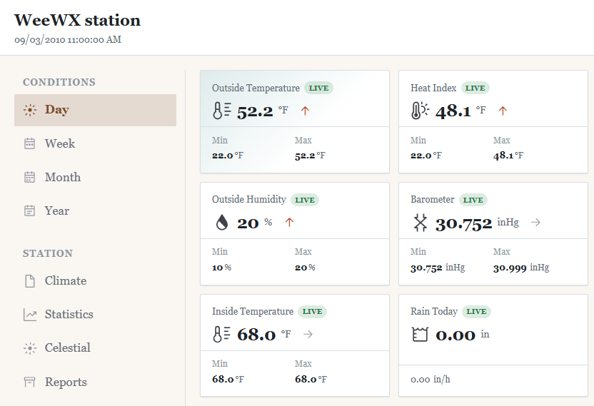
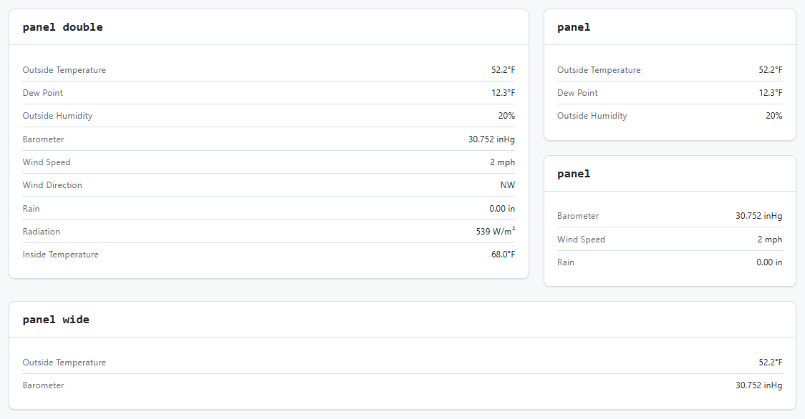

# The *Horizon* skin

The *Horizon* skin takes advantage of the [JSON generator](json-generator.md) to
create a dynamic representation of the data from your weather station. It uses
the charting package [ECharts](https://echarts.apache.org/) (included with the
skin) to draw scalable charts with features such as tooltips, and switchable
unit systems.

This document is a guide to performing various common tasks when customizing the
skin. For a definitive reference guide to its various options see the page
[*`[DisplayOptions]` for the *Horizon* skin*](../reference/skin-options/displayoptions_Horizon).

## Turning the skin on

If you are upgrading from WeeWX V5.5 or earlier, see the Upgrade Guide section
[*Upgrading to V5.6*](../upgrade#upgrading-to-v56) for instructions on how to
install the new skin.

If you are doing a completely new installation, all available skins, including
*Horizon*, will be installed. However, `HorizonReport` in `weewx.conf`, will be
switched off. To switch it on, set `enable` to `true`, then restart WeeWX:

``` ini hl_lines="5"
[StdReport]
    ...
    [[HorizonReport]]
        skin = Horizon
        enable = true
        HTML_ROOT = public_html/horizon
```

## Finding your way around

Every page is laid out the same way: a masthead across the top, navigation in a
column on the left, the page's content beside the navigation, and a footer under
the content. Here is the front page at a desktop width:



The masthead holds the page's title and the time of the latest archive record.
On every page but the front page, a link under the title goes back to the front
page. The button with the sun or the moon, at the right of the masthead,
switches between the light and the dark theme. The browser remembers the
choice. Until a reader chooses, the page follows the theme of the reader's
system.

The navigation has three parts:

* **CONDITIONS** has one entry for each time span in option 
  [`periods`](../reference/skin-options/displayoptions_Horizon/#periods).
  By default, this is `day, week, month, year`. On the front
  page, clicking on a time span switches the charts and the tiles of the
  current conditions to that time span. On every other page, the entry opens the
  front page for that time span.
* **STATION** links to other pages. *Climate* shows the year in progress:
  the climatological days, such as frost days; charts of the year month by
  month; a heat map of the year, with one square for each day; and a table of
  every year in the archive, month by month. *Statistics* has the highs, lows,
  and totals for the day, week, month, year, and rain year. *Celestial* has the
  sun and the moon in detail. *Reports* shows the NOAA summaries of each month
  and year. *Telemetry* has the station's signal, batteries and voltages, and
  charts of the signal and the voltages.
* **UNITS** and **LANGUAGE** hold the unit picker and the language picker. The
  unit picker shows the readings in another unit system: `US`, `METRIC` or
  `METRICWX`. *Default* is the report unit system. The browser converts the
  readings, the charts included, and remembers the choice for the next visit.
  The *Celestial* and *Reports* pages have no unit picker. The language picker 
  appears when the pages are published in more than one language. See
  [Choosing the language](#choosing-a-language).

On a screen 960 pixels wide or narrower, such as a phone or a tablet held
upright, the navigation is hidden. The menu button at the right of the masthead
opens the navigation as a menu over the page:

{ width="300" }

In a browser that runs no JavaScript, there is no menu button, and the
navigation stays in the page, under the masthead.

Following the navigation area is a set of *panels*. In the graphic above, there
are panels for the current conditions (top), sun and moon (below the current
conditions), and planets.

The footer of every page, except the climate pages of past years, gives the
station's latitude, longitude and altitude, its hardware, how long WeeWX has
been running, and the version of WeeWX.


## Customizing *Horizon*

The next few sections explain how to customize the skin. The various options it
offers are documented in the reference section [*`[DisplayOptions]` for the
Horizon skin*](../reference/skin-options/displayoptions_Horizon).

### Changing the panels

What panels appear and in what order is given by option
[`panels`](../reference/skin-options/displayoptions_Horizon.md#panels):

``` ini
[DisplayOptions]
    ...
    panels = current, forecast, sunmoon, planets, imagery, sensors, history, hilo
    ...
```

The [reference section](../reference/skin-options/displayoptions_Horizon.md#panels) 
for `panels` lists all the panels that are available.

The panels are laid out on a grid, with as many columns as there is room for. A
column is at least 336 pixels wide. Most panels take one column, while
`current`, `forecast`, `history` and `hilo` span the whole row. Panel `sunmoon`
spans two columns and two rows when the grid has three columns, as in the
picture of the front page above.

The panels keep the order of the list, even when that leaves a gap. For
example, if a panel that takes one column is followed by a panel that spans
the entire row, the rest of the first panel's row stays empty.

#### Panel `current`

Picking a time span sets what the current conditions tiles show. For *Day*, a
tile shows the latest reading, with the day's low and high under it. For *Week*,
*Month*, or *Year*, a tile shows the average of that week, month, or year so far,
with its low and high. Rain, and any other type in `obs_type_sum`, shows the
total instead, and the wind tile shows the mean speed and the vector averaged
direction. The trend arrows, the rain rate, and the *Live* badge describe the
latest reading, so they are shown only on *Day*.

With the live update on, when no new archive record has arrived for two and a
half archive intervals, the current conditions and the time in the masthead
are shown faded.

#### Celestial panels

Panels`sun`, `moon`, `sunmoon` and `planets` need `pyephem`, and show nothing
if it is not installed.

The curve of the sun panel is drawn against the station's clock, not against
solar time.

The moon pictures are NASA's, and in the public domain. The file
`moon/LICENSE.txt` has the details.

#### Panel `history`

Panel `history` holds the charts. Which charts `history` shows, and in what
order, is set by option
[`plot_groups`](../reference/skin-options/displayoptions_Horizon/#plot_groups).
Typically, it looks something like:

``` ini
[DisplayOptions]
    ...
    plot_groups = tempdew, tempfeel, hum, barometer, wind, winddir, windvec, rain
    ...
```

The range bar steps the charts back and forward, one time span at a time. The
date between the arrows opens a calendar, which can send you to any date.
Clicking *Now* returns to the latest readings. Clicking *Share* copies a link to
what the charts show, such as `index.html#month/2026-07` for July 2026. Over
plain HTTP the browser lets no page write to the clipboard, so *Share* shows the
link in a box for the reader to copy. A link to `index.html#week` opens the
front page on the time span Week*. The range bar moves only the charts: the
other panels stay on the day, week, month, or year that holds the latest archive
record.

The charts shade the nights on time spans of up to nine days, i.e., *Day* and
*Week*. Longer time spans (*Month*, *Year*) do not show nights.


### Adding a new chart

Adding a new chart involves two steps: arranging for its JSON data to be
generated, then instructing the *Horizon* skin to include it in the history
panel. Let's go through an example where we add a chart that includes two
temperatures: `inTemp` and `inDewpoint`, the inside temperture and dewpoint. We
wish to show these two temperatures on the same chart.

#### Generate its JSON data

This is covered in the section XXXX. You should end up with a section that looks
like:

``` ini
[JSONGenerator]
    ...
    [[JSONFiles]]
        ...
        [[[intempdew]]]
            [[[[inTemp]]]]
            [[[[inDewpoint]]]]
```

This will generate the necessary files to support plot group `intempdew`. 

#### Include it in the history panel

Next step is to describe how the chart will appear and to make sure it is included. This is done 
under `[DisplayOptions]`. 

``` ini
[DisplayOptions]
    ...
    plot_groups = tempdew, tempfeel, hum, barometer, wind, winddir, windvec, rain, intempdew
    ...    
```

Without anything else, this will produce a chart with inside temperature and
dewpoint using default values for scaling, plot type, and labeling. 

However, suppose you wish to include a custom label and use a custom scaling. In
this case, you will need to add the customization under `[[Charts]]`.

``` ini
[DisplayOptions]
    ...
    plot_groups = tempdew, tempfeel, hum, barometer, wind, winddir, windvec, rain, intempdew
    ...
    [[Charts]]
        label = Living room temperature and dewpoint
        yscale = 60, 100, None
        [[[intempdew]]]
```


These are the various options available for customization:

| Option          | What it does                                                                                                                                                                                                                                                                               |
|-----------------|--------------------------------------------------------------------------------------------------------------------------------------------------------------------------------------------------------------------------------------------------------------------------------------------|
| `plot_type`     | How the series are drawn: `line`, `bar` or `vector`. A `vector` chart needs a series of the type `windvec` or `windgustvec`. Default is `line`.                                                                                                                                            |
| `yscale`        | A 3-way tuple (`ylow`, `yhigh`, `min_interval`), where `ylow` and `yhigh` are the minimum and maximum y-axis values, respectively, and `min_interval` is the minimum tick interval. If set to `None`, the corresponding value will be automatically chosen. Default is `None, None, None`. |
| `vector_rotate` | For a `vector` chart, the angle in degrees by which the arrows are turned, as in the Image generator. Default is `0`, and the `skin.conf` of *Horizon* sets `90`.                                                                                                                          |
| `label`         | On a series, the label shown in the legend and in the tooltip. Default is the generic label of the type.                                                                                                                                                                                   |


### Changing colors through stylesheets

The colors that *Horizon* uses come from a stylesheet and not from
`[DisplayOptions]`. Best practice is to set the properties in your own
stylesheet, rather than modify the stylesheet that comes with *Horizon*. Here's
how. Set option `custom_css` to the location of your custom stylesheet:

``` ini
[DisplayOptions]
    custom_css = my-station.css
```

Every page loads the custom stylesheet after `horizon.css`, so it overrides the
latter. Put the file in the skin directory, and add it to `copy_once` in
`[CopyGenerator]`. WeeWX copies the files in `copy_once` to `HTML_ROOT` with the
first report after it starts, and with `weectl report run`. After a change to
the stylesheet, restart WeeWX, or run `weectl report run`.


The colors, fonts, and spacing of the skin can all be changed by changing the
stylesheet. For example:

``` css
:root {
  --accent: #7a4b2c;
  --bg: #faf6f2;
  --radius: 2px;
  --font: Georgia, "Times New Roman", serif;
}

@media screen and (prefers-color-scheme: dark) {
  :root:not([data-theme="light"]) { --accent: #d8a77a; --bg: #1a1512; }
}
@media screen {
  :root[data-theme="dark"] { --accent: #d8a77a; --bg: #1a1512; }
}
```

The first rule sets the colors of the light theme, and the corners and the font
of both themes. The dark theme has two rules, as in `horizon.css`: one for a
reader whose system is dark and who has not chosen a theme, and one for a reader
who chose dark with the theme button. A color for the dark theme goes in both
rules. Put the dark rules inside `@media screen`, as the skin does, so that a
page still prints in the light colors. With this stylesheet, the top of the
front page looks as follows:



#### The names you can set

Each name in this table is written `--name` in a stylesheet, as in the example
above.

| Name                                          | What it sets                                                                                                            |
|-----------------------------------------------|-------------------------------------------------------------------------------------------------------------------------|
| `bg`                                          | The page behind the panels                                                                                              |
| `surface`, `surface-sunk`                     | Panels, tiles and the masthead; a row of tabs, and a chart that is not yet drawn                                        |
| `ink`, `ink-muted`, `ink-faint`               | Text; labels; the headings of the navigation, and the small print                                                       |
| `border`, `border-strong`                     | The edges of panels and tiles, and the rules between rows; an edge under the pointer                                    |
| `accent`                                      | Links, and what is selected: the page or time span shown, a tab                                                         |
| `hi`, `lo`                                    | Highs and lows, and a rising and a falling trend; temperature and rain on the climate page                              |
| `ok`                                          | The *Live* badge, and a battery that is OK                                                                              |
| `sun`                                         | The sun's curve, a planet above the horizon, and a clear sky in the forecast                                            |
| `warn`, `accent-bright`                       | A partly cloudy sky, and snow, in the forecast                                                                          |
| `warm-0` … `warm-8`                           | The temperature bands, cold to hot: the tint of the outside temperature tile, and the heat map on the climate page      |
| `chart-grid`, `chart-axis`, `chart-night`     | Inside the charts: the grid, the axes, and the shading of the night                                                     |
| `chart-lines`, `chart-fills`                  | The colors of the lines of the charts, and of the bars. See [Changing the colors of the charts](#changing-chart-colors) |
| `radius`, `shadow`                            | The corners and the shadow of panels and tiles                                                                          |
| `gap`, `edge`, `pad`                          | The space between panels, the margin at either side of the page, and the space inside a panel                           |
| `font`, `font-mono`                           | The typeface of the page, and of the NOAA reports                                                                       |
| `fs-xs`, `fs-sm`, `fs-base`, `fs-md`, `fs-lg` | Type sizes, from the small print to the page title                                                                      |

Give the `warm` colors as `#rrggbb` or `rgb()`. The heat map on the climate page
mixes the `warm` colors in the browser, and skips a color written any other way.

#### Changing chart colors

Two custom properties hold the colors used by the charts. Each is one quoted
string of colors with commas between them.  A color can be anything CSS accepts.

``` css
:root {
  --chart-lines: "#4282b4, #b44242, #42b442, #42b4b4, #b442b4";
  --chart-fills: "#72b2c4, #c47272, #72c472, #72c4c4, #c472c4";
}
```

The first line of a chart takes the first color, the second line the second, and
so on. A chart with more lines than there are colors starts again at the first.
Option `--chart-lines` also colors the series names above the chart. Similarly,
`--chart-fills` colors the bars, such as those of rain. The quotes keep the
commas inside the string.

Every chart sits in a card that carries its plot group in `data-group`. The
group is the name of the plot group under `[[JSONFiles]]`, e.g., `tempdew`. A
rule on the card gives one chart colors of its own and leaves the others alone:

``` css
.chart-card[data-group="tempdew"] {
  --chart-lines: "#1d6fa5, #e08a1e";
}
```

### Setting a forecast

If the file `$HTML_ROOT/data/forecast.json` exists, the forecast panel gets the
forecast from there. Otherwise, if `browser_fetch` is truthy, the browser asks
[Open-Meteo](https://open-meteo.com/) for a forecast. Without a forecast from
either source, the panel stays hidden. The browser keeps a forecast for an hour.

``` ini
[DisplayOptions]
    [[Forecast]]
        browser_fetch = true
        days = 7
        hours = 8
```

| Option          | What it does                                                                                                                                               |
|-----------------|------------------------------------------------------------------------------------------------------------------------------------------------------------|
| `browser_fetch` | Whether the browser may ask Open-Meteo for a forecast, `true` or `false`. Default is `true`.                                                               |
| `days`          | How many days to ask Open-Meteo for. The panel shows every day that `forecast.json` holds. Default is `7`.                                                 |
| `hours`         | How many forecast times to show for the day the reader selects, three hours apart. Today's first time is the present hour. Default is `8`, i.e., 24 hours. |

When the browser asks Open-Meteo, the reader's IP address reaches a third party.
The request carries the station's position, rounded to three decimals, which is
about 100 meters. On a public website, consider using `forecast-fetch.py`,
described below, and setting `browser_fetch = false`.

The script `forecast-fetch.py`, located in the skin directory, asks Open-Meteo
for a forecast and writes the file `forecast.json`. The script needs only Python
3, not WeeWX, so the script can also run on a web server without WeeWX. This
crontab line runs the script at seven minutes past every hour. Adjust the
position and the paths to your station:

```
7 * * * * python3 /etc/weewx/skins/Horizon/forecast-fetch.py --lat 45.686 --lon -121.566 --out /var/www/html/weewx/horizon/data/forecast.json
```

Any other program can write the file instead. Write the file to
`data/forecast.json` under the report's `HTML_ROOT`, with temperatures in °C and
wind speeds in km/h. The skin does not read the file's `units` field. For
example:

``` json
{
  "source": "my-script",
  "run": "2026-09-11T06:00",
  "units": {
    "temperature": "°C",
    "wind": "km/h"
  },
  "days": [
    {
      "date": "2026-09-11",
      "code": 61,
      "high": 21.4,
      "low": 12,
      "rain": 70,
      "wind": 18
    }
  ],
  "hours": [
    {
      "time": "2026-09-11T15:00",
      "code": 61,
      "temperature": 19.8,
      "rain": 60
    }
  ]
}
```

The docstring of `to_horizon()` in `forecast-fetch.py` describes each field. A
program of this kind could convert the forecasts of
[*weewx-forecast*][forecast-wiki] or [*weewx-DWD*][dwd].

  [forecast-wiki]: https://github.com/weewx/weewx/wiki/forecasting
  [dwd]: https://github.com/roe-dl/weewx-DWD


### Choosing a language

As for any skin, the report's `lang` option chooses the language. See
[Changing languages](custom-reports.md#changing-languages). The language files
are in `lang/`. Where a language file lacks a text, the page shows the English
text. To supply the missing texts, see [Localization](localization.md).

To publish the pages in more than one language, add one report for each
language to `[StdReport]`, each with its own `lang` and `HTML_ROOT`, as described
in [Multiple locales](custom-reports.md#multiple-locales). Put the pages of one
language at the top, in the report's `HTML_ROOT`, and the pages of each other
language in a subdirectory of that `HTML_ROOT`. A report that writes to a
subdirectory also needs `lang_root`, the path from its `HTML_ROOT` back to the
top:

``` ini hl_lines="14"
[StdReport]
    ...
    [[HorizonReport]]
        skin = Horizon
        enable = true
        lang = de
        HTML_ROOT = public_html/horizon
    [[HorizonReportEN]]
        skin = Horizon
        enable = true
        lang = en
        HTML_ROOT = public_html/horizon/en
        [[[DisplayOptions]]]
            lang_root = ..
```

Then list the languages under `[[Languages]]` in `skin.conf`, each with the path
from the top to the `HTML_ROOT` of its report:

``` ini
[DisplayOptions]
    ...
    [[Languages]]
        [[[de]]]
            label = Deutsch
            path = .
        [[[en]]]
            label = English
            path = en
```

With more than one entry, the navigation has a language picker. Name each entry
after the `lang` of its report, so that the picker shows the language of the
page it is on.

### Customizing icons

A tile of the current conditions can have a small icon, chosen by observation
type. To change an icon, or to give one to a type that has none, name a file
under `[[Icons]]`:

``` ini
[DisplayOptions]
    [[Icons]]
        extraTemp1 = temp
        extraHumid1 = humidity
```

The value is the name of an SVG file in `icons/`, without the extension. The
icon is drawn in the color of the text, in the light and the dark theme alike,
so only the shape of the SVG counts, not its colors. A type that has no icon in
the skin and no entry under `[[Icons]]` shows no icon. The icons that come with
the skin are from the IBM Carbon set, under the Apache 2.0 license. See
`icons/LICENSE-Carbon.txt`.

## Adding a panel of your own

A panel is an `.inc` file in the skin directory. To add a panel of your own,
write an `.inc` file, and add the file's name, without `.inc`, to `panels`. You
do not have to edit `index.html.tmpl`.

Suppose you would like to show the temperature of a pond, measured as
`extraTemp1`. Save the following as `pond.inc` in the skin directory:

```
#errorCatcher Echo
#encoding UTF-8
<section class="panel" data-live-panel="pond">
  <div class="panel-head"><h2>Pond</h2></div>
  <div class="panel-body">$current.extraTemp1</div>
</section>
```


The class of the `section` sets how much of the grid the panel takes. Class `panel`
takes one column, `panel wide` spans the whole row, and `panel double` spans two
columns and two rows when the grid has three columns and only one column when
the grid has fewer. Here is a panel of each class, on a grid of three columns:



Attribute `data-live-panel` keeps the panel up to date, as long as `refresh_interval` is
not `0`. When a new archive record arrives, the browser fetches the page again
in the background, and puts the new version of each panel with a
`data-live-panel` attribute in place of the old one. The browser finds the new
version by the name in the attribute, so give each panel a name that no other
panel uses. Without the attribute, a panel stays as it was when the reader
loaded the page.

Then add `pond` to `panels`, at the place where you would like the panel to
appear. For example, if you wanted it to appear after `planets`:

``` ini
[DisplayOptions]
    panels = current, forecast, sunmoon, planets, pond, imagery, sensors, history, hilo
```

The unit picker does not convert the reading of a simple panel like this. For a
reading that the unit picker converts, write it this way:

```
<span data-obs="extraTemp1" data-value="$current.extraTemp1.raw"
      data-unit="$unit.unit_type.extraTemp1"><span data-unit-value>$current.extraTemp1.format(add_label=False)</span><small data-unit-label>$unit.label.extraTemp1</small></span>
```

## Adding a script of your own

Name a script of your own in `custom_js`:

``` ini
[DisplayOptions]
    custom_js = my-station.js
```

As with a stylesheet, put the file in the skin directory, and add it to
`copy_once`. Every page loads its scripts at the end of the page, in this order:
the chart library `echarts.min.js`, on the pages that have charts; the skin's
`weewx-json.js`, which reads the JSON files, and `horizon.js`; the page's own script, `forecast.js` or `climate.js`; then the
scripts in `custom_js`, in the order of the list. When a script of your own
runs, the page is complete, and the skin has set up its controls.

The skin sends these events to `document`, for a script that has to keep up
with the page:

| Event            | When                                                                                                                                                                      |
|------------------|---------------------------------------------------------------------------------------------------------------------------------------------------------------------------|
| `horizon:update` | A new archive record has arrived. `event.detail.dateTime` is the time of the archive record, as a Unix epoch time.                                                        |
| `horizon:panels` | The panels with a `data-live-panel` attribute have been replaced with their new versions. Whatever a script added to one of those panels is gone, and can be added again. |
| `horizon:units`  | The reader has chosen another unit system.                                                                                                                                |


### Combined example

All of this can be customized in a manner similar to the Image generator. For
example, to show `extraTemp5` as a bar chart of hourly averages with a custom
label, two changes need to be made. First, the JSON generator needs to be told
to calculate hourly averages:

``` ini
[JSONGenerator]
    ...
    [[JSONFiles]]
        [[[tempext5]]]
            aggregate_type = avg
            aggregate_interval = 1h
            [[[[extraTemp5]]]]
```

Then the browser client needs to be told to show bar charts, with a custom
label:

``` ini
[DisplayOptions]
    [[Charts]]
        [[[tempext5]]]
            plot_type = bar
            [[[[extraTemp5]]]]
                label = Temperature (hourly average)
```

## The climate page

The climatological days use their metric definitions, e.g., a summer day reaches
25 °C. On a page in US units the thresholds are converted, so the summer day's
threshold reads 77 °F.

The climate diagram is laid out in °C and mm, because Walter and Lieth's ratio of 20 mm
to 10 °C is defined in those units. Where *Default* is selected in the unit picker,
the axis labels and the tooltip are in °C and mm as well, whatever the unit system
of the report. Where a unit system is selected, they are in the units of that system.

The water balance appears only where the station has rain and
evapotranspiration (`ET`) data. WeeWX calculates `ET` from solar radiation,
among other readings, so a station without a radiation sensor has none.

## The climate pages of past years

Each year of the archive has a climate page of its own, such as
`climate-2025.html`, which the year picker on the Climate page opens. WeeWX
stops writing the page of a year when the year ends, so the page of a past year
stays as the templates wrote it in that year's last report. After a change to
the templates or to `skin.conf`, delete the pages of past years, and the next
report writes them again.
